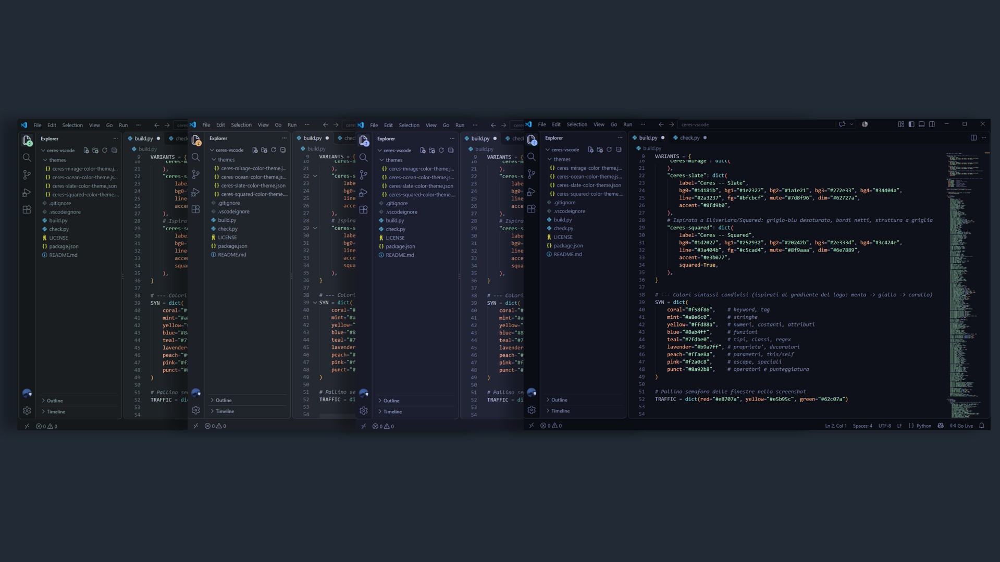

# Ceres

A dark theme for VS Code available in four variants, inspired by the [Juno](https://github.com/EliverLara/Juno) and [Squared](https://github.com/EliverLara/Squared) GTK themes by EliverLara. It features flat, understated surfaces and syntax highlighting with pastel accents in mint, yellow, and coral.



## Variants

Once installed, you can find them in the theme selector (`Ctrl+K Ctrl+T`):

| Variant | Editor | Character |
|---|---|---|
| **Ceres -- Ocean** | `#0f111a` | Deep midnight blue; the darkest option |
| **Ceres -- Mirage** | `#212536` | A softer, more readable blue-violet |
| **Ceres -- Slate** | `#1e2327` | Grey-green with a mint accent |
| **Ceres -- Squared** | `#252932` | Desaturated grey-blue with an amber accent and sharp, grid-like edges |

## Installation

**Via `.vsix` file** (download it from the *Releases* section of the repository):

1. Open the Extensions panel (`Ctrl+Shift+X`).
2. Click the `…` menu in the top-right corner and select **Install from VSIX…**.
3. Select `ceres-vscode-0.3.1.vsix`.
4. Press `Ctrl+K Ctrl+T` and choose a Ceres variant. Or via the terminal:

```bash
code --install-extension ceres-vscode-0.3.1.vsix
```

## Colors

Syntax highlighting is shared across the variants; the interface surfaces and accent colors differ.

| Color | Value | Used for |
|---|---|---|
| Coral | `#f58f86` | keywords, tags |
| Mint | `#a8e6c0` | strings |
| Yellow | `#ffd88a` | numbers, constants, attributes |
| Blue | `#8ab4ff` | functions |
| Teal | `#7fdbe0` | types, classes, regex |
| Lavender | `#b9a7ff` | properties, decorators |
| Peach | `#ffae8a` | parameters, `this` / `self` |

Red (`#e8707a`), yellow (`#e5b95c`), and green (`#62c07a`)—the colors of the window control dots—are used for Git, errors, warnings, and debugging. Bracket color-coding follows the gradient: yellow, coral, mint, blue.

| Variant | Accent | Sidebar | Title bar / Status bar |
|---|---|---|---|
| Ocean | `#8ab4ff` | `#131622` | `#0b0d14` |
| Mirage | `#9fb4ff` | `#1c1f2f` | `#181a28` |
| Slate | `#8fd9b0` | `#1a1e21` | `#14181b` |
| Squared | `#e3b077` | `#20242b` | `#1d2027` |

Text and tokens exceed a 4.5:1 contrast ratio against the editor background; line numbers meet a 3:1 ratio.

## Design Choices

- **Stepped Surfaces**: The title bar, activity bar, and status bar share the same color, while the sidebar and editor are elevated by one "step." No heavy borders.
- **Gradient-Inspired Accents**: The syntax uses mint, yellow, and coral—the colors found in the gradient of the theme's logo, which served as the project's inspiration.
- **Squared**: "Squared" is a GTK theme featuring square corners and a restful palette, though it does not publicly expose its color values. This variant captures its essence: a 1px divider between each area, no drop shadows, solid selection highlights, and desaturated tones. The specific color palette and the amber accent color were chosen by Ceres.
## If the colors don't change

User settings take precedence over the theme. If the backgrounds remain unchanged (for instance, appearing as a gray like `#1e1e1e`), open **Preferences: Open User Settings (JSON)** and check for a `workbench.colorCustomizations` block that might be overriding them—remove or comment it out. Also, check the `.vscode/settings.json` file within your project, as well as any extensions that inject custom CSS.

## Development

The theme files located in `themes/` are generated by `build.py`; the color palettes are defined within `VARIANTS` and `SYN`.

```bash
python3 build.py              # regenerates themes/*.json
python3 check.py              # validates the JSON files and checks WCAG contrast ratios
npx @vscode/vsce package      # creates the .vsix file
```

## Credits

The style of Ceres is inspired by the GTK themes [Juno](https://github.com/EliverLara/Juno) and [Squared](https://github.com/EliverLara/Squared) by EliverLara. It does not use any of their code or files; the color palettes and rules have been written from scratch for VS Code.